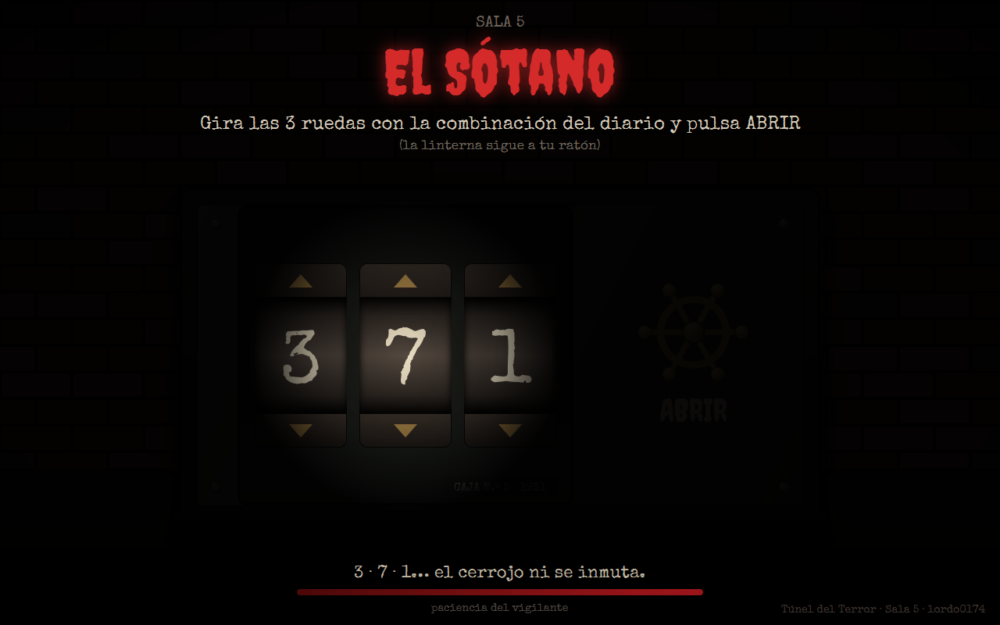
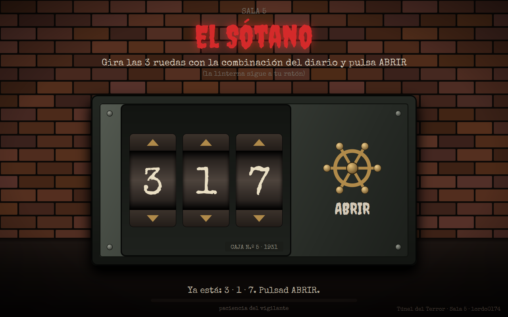
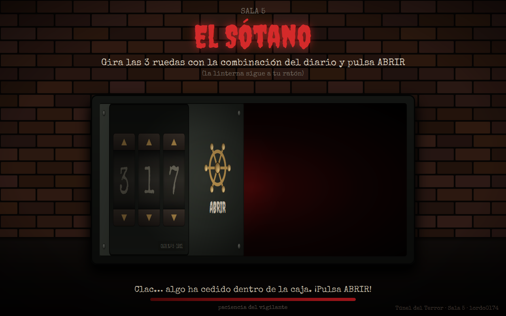
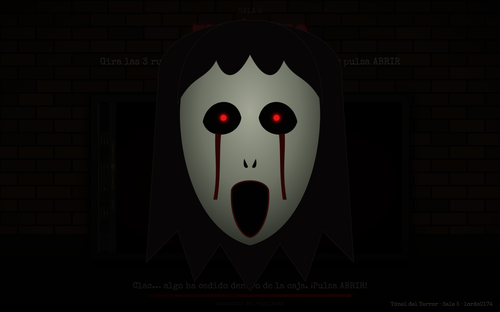
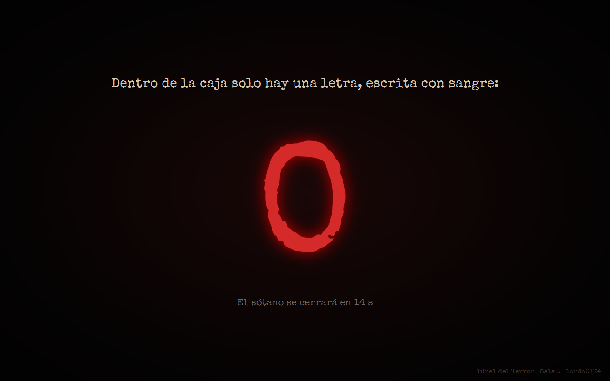

# Túnel del Terror · Sala 5 — «El Sótano»

Aplicación JavaFX de la **sala 5** del Túnel del Terror. El visitante llega con la combinación que ha encontrado en el diario del vigilante (la página HTML de 1.º), baja a un sótano a oscuras con una linterna, abre la caja fuerte y, dentro, encuentra **la letra de la sala**.

Autor: **lordo0174** · Proyecto Maven · JavaFX 21


---

## La sala

El vigilante del túnel bajó una noche al sótano y no volvió a subir. El reloj de abajo se paró a las 3:17. Solo queda su diario y una caja fuerte con tres ruedas de combinación. La bombilla está fundida: el grupo tiene una linterna, y nada más.

La interfaz es una pesadilla diseñada a propósito:

- **Todo está a oscuras.** Solo se ve el círculo que alumbra la linterna, que sigue al ratón. Para leer una rueda hay que apuntarla; en cuanto mueves la luz hacia la manivela, los números vuelven a desaparecer.
- **Las ruedas se mueven solas.** Si nadie toca la caja durante 7 segundos, algo gira una de las ruedas con un chirrido («Algo ha girado una de las ruedas en la oscuridad…»), y en la oscuridad no sabes cuál.
- **Sonido opresivo:** un dron grave con viento y gotas que caen con eco, el clic metálico de cada rueda, el golpe del cerrojo al fallar y latidos de corazón en los últimos 15 segundos antes de la ayuda.

Aun así, en 5 segundos se entiende qué hay que tocar: los textos están **por encima de la oscuridad** y siempre se leen, hay una única instrucción («Gira las 3 ruedas con la combinación del diario y pulsa ABRIR»), la linterna empieza apuntando a las ruedas, y solo hay dos cosas que tocar: tres ruedas con flechas y una manivela con la palabra ABRIR.

## La pista acordada con 1.º

| | |
|---|---|
| **Alumno/a de 1.º (mentorizado)** | _(nombre del alumno o alumna de 1.º)_ |
| **Página de 1.º** | El diario del vigilante |
| **Pista** | La combinación **3 · 1 · 7** |
| **Cómo aparece en el diario** | Tres entradas del diario tienen una cifra manchada de sangre, en este orden: «Bajé los **3** escalones podridos…», «Solo me queda **1** vela…», «Esta noche he contado **7** golpes dentro de la caja…». La última página lo confirma: el reloj del sótano se paró a las **3:17**. |
| **Letra que entrega la sala 5** | **O** |

Si con 1.º se cambia la pista o la letra, solo hay que tocar las constantes `COMBINACION` y `LETRA` de `SalaController.java`.

## Cómo se juega

1. El grupo llega con la combinación. La sala espera «dormida» hasta que alguien toca el ratón o el teclado: ahí empieza la **paciencia del vigilante** (60 s). Las ruedas aparecen cada vez en una posición al azar.
2. Mueve el ratón para alumbrar la caja. Gira cada rueda con sus **flechas**, con la **rueda del ratón** encima de ella o con las flechas del teclado. Del 9 se pasa al 0.
3. Cuando las tres ruedas están en su número suena un *clac* y aparece «Clac… algo ha cedido dentro de la caja. ¡Pulsa ABRIR!».
4. Pulsa **ABRIR** (o Intro):
   - Si la combinación no es la buena: golpe de metal, la caja tiembla, la manivela forcejea contra el cerrojo y aparece un mensaje con lo que han marcado («3 · 7 · 1… el cerrojo ni se inmuta.»).
   - Si es la buena: la manivela da media vuelta, la puerta se abre, **susto controlado** y, después, **la letra**.
5. La letra se queda 15 segundos en pantalla con una cuenta atrás y la sala **se reinicia sola** para el siguiente grupo.

### Siempre se puede ganar

| Momento | Qué pasa |
|---|---|
| 7 s sin tocar la caja | Una rueda gira sola (solo asusta: nunca impide ganar) |
| 45 – 60 s | Suenan latidos de corazón cada segundo |
| **60 s** | **La sala se apiada:** se enciende la bombilla (la oscuridad se desvanece), las ruedas giran solas hasta 3 · 1 · 7, el botón ABRIR late y el mensaje dice «Ya está: 3 · 1 · 7. Pulsad ABRIR.» |
| 80 s | Si todavía no han abierto, la caja se abre sola y entrega la letra |

### El susto

Al abrirse la puerta, la sala se oscurece y una cara pálida con los ojos rojos **sale de la caja creciendo** (de 0,2 a 1,3 de escala) con un golpe sonoro, y se desvanece. Es un susto controlado: **solo aparición y escala, sin destellos**, sin flashes blancos ni parpadeos; tampoco la linterna parpadea nunca. Se puede desactivar con `SUSTO_ACTIVADO = false` en `SalaController.java` (por ejemplo, si viene un grupo con niños pequeños).

## Capturas

| | |
|---|---|
|  |  |
| **Inicio.** Todo a oscuras salvo lo que alumbra la linterna. | **Fallo.** La caja tiembla y el mensaje repite la combinación marcada. |
|  |  |
| **A los 60 s la sala se apiada:** luz encendida y ruedas colocadas. | **La puerta se abre** sobre su bisagra y deja ver el interior. |
|  |  |
| **Susto controlado:** aparición y escala, sin destellos. | **La letra**, con un brillo que «respira» y cuenta atrás para reiniciarse. |

## Cómo ejecutarlo

Requisitos: **JDK 21** o superior y **Maven 3.9** (sirve el que trae IntelliJ IDEA).

```bash
mvn clean javafx:run
```

Desde **IntelliJ IDEA**: abrir la carpeta del proyecto (si no lo detecta como Maven, clic derecho en `pom.xml` › *Add as Maven Project*) y, en el panel **Maven**, ejecutar `Plugins › javafx › javafx:run`.

La sala arranca a pantalla completa, sin el aviso de «Pulsa Esc para salir» y sin que Esc la cierre.

| Tecla | Para qué |
|---|---|
| **F12** | Reinicia la sala en cualquier momento (para el monitor de la sala) |
| **Ctrl + Mayús + Q** | Cierra la aplicación (salida del monitor; un visitante no la pulsa por accidente) |
| **Intro** | Equivale a pulsar ABRIR |
| **↑ / ↓** y rueda del ratón | Giran la rueda que tiene el foco o la que está bajo el ratón |

### Ajustes (constantes de `SalaController.java`)

| Constante | Valor | Qué controla |
|---|---|---|
| `COMBINACION` | `{3, 1, 7}` | La combinación de la caja (la pista de 1.º) |
| `LETRA` | `"O"` | La letra que entrega la sala |
| `SUSTO_ACTIVADO` | `true` | Activa o desactiva la cara del susto |
| `SEGUNDOS_DERIVA` | `7` | Segundos sin tocar la caja antes de que una rueda gire sola |
| `SEGUNDOS_PIEDAD` | `60` | Cuándo la sala se apiada |
| `SEGUNDOS_LETRA_REGALADA` | `80` | Cuándo regala la letra si no han abierto |
| `SEGUNDOS_REINICIO` | `15` | Tiempo que se ve la letra antes de reiniciarse |

`PROPIETARIO` (en `App.java`) guarda el usuario de GitHub y aparece en el título de la ventana y en la firma de la esquina.

### Regenerar los sonidos

Todos los sonidos se generan por síntesis con un programa propio. Para volver a crearlos (desde la raíz del proyecto):

```bash
java herramientas/GenerarSonidos.java
```

## Estructura del proyecto

```
tunel-terror-javafx-grupo4/
├── pom.xml
├── herramientas/
│   └── GenerarSonidos.java          # sintetiza los WAV de la sala
├── docs/capturas/                    # capturas del README
└── src/main/
    ├── java/
    │   ├── module-info.java
    │   └── es/medac/lordo0174/tunel/
    │       ├── App.java              # pantalla completa, fuentes, F12, PROPIETARIO
    │       └── SalaController.java   # lógica, linterna, animaciones y sonido
    └── resources/es/medac/lordo0174/tunel/
        ├── sala.fxml                 # vista (se edita con Scene Builder)
        ├── sala.css                  # tema oscuro
        ├── fuentes/                  # Creepster y Special Elite + licencias
        └── sonidos/                  # ambiente, rueda, clac, cerrojo, chirrido, puerta, susto, letra, latido
```

## Requisitos de la práctica

| Requisito | Dónde está |
|---|---|
| Maven + JavaFX 21 (controls, fxml, media), `mvn clean javafx:run` | `pom.xml`, `module-info.java` |
| Paquete `es.medac.lordo0174.tunel` | `src/main/java/es/medac/lordo0174/tunel` |
| FXML `sala.fxml`, controlador `SalaController`, CSS oscuro | `resources/.../sala.fxml`, `sala.css` |
| Fuente cargada con `Font.loadFont` | `App.cargarFuente()` (Creepster y Special Elite) |
| Constante `PROPIETARIO` en el título | `App.PROPIETARIO` → `stage.setTitle(...)` |
| Pantalla completa sin aviso ni salida accidental | `setFullScreen(true)`, `setFullScreenExitHint("")` y `setFullScreenExitKeyCombination(KeyCombination.NO_MATCH)` en `App.start()` |
| Transition / Timeline | `FadeTransition` (título, bombilla, letra), `ScaleTransition` (letra, botón que late), `TranslateTransition` (caja y ruedas que tiemblan), `RotateTransition` (manivela que forcejea), `Timeline` (reloj, linterna que respira, giro automático de las ruedas, apertura de la puerta, susto, brillo de la letra, cuenta atrás) |
| Ambiente en bucle con `MediaPlayer` | `ambiente.wav` con `MediaPlayer.INDEFINITE` |
| Efectos con `AudioClip` | rueda, clac, cerrojo, chirrido, puerta, susto, letra y latido |
| Validar la pista y mostrar la letra con un efecto | `abrir()` → `revelar()` → `mostrarLetra()` (fundido, escala y brillo) |
| Susto controlado (aparición o escala, sin destellos) | `asustar()` y `crearSusto()` |
| Siempre se puede ganar (60 s) | `tic()` → `apiadarse()` y letra regalada a los 80 s |
| Autorreinicio y F12 | `ticReinicio()` → `reiniciar()`; F12 en `App` |

## Créditos

- **Creepster** — Sideshow / Font Diner, Inc. Licencia SIL Open Font License 1.1 (`fuentes/Creepster-OFL.txt`). Descargada de [Google Fonts](https://github.com/google/fonts/tree/main/ofl/creepster).
- **Special Elite** — Astigmatic (Brian J. Bonislawsky). Licencia Apache 2.0 (`fuentes/SpecialElite-LICENSE.txt`). Descargada de [Google Fonts](https://github.com/google/fonts/tree/main/apache/specialelite).
- **Sonidos** — originales, sintetizados por código con `herramientas/GenerarSonidos.java` (dron, viento, gotas, trinquete, cerrojo, chirridos, golpe del susto, campana y latido). No se ha usado ninguna grabación externa.
- **Imágenes** — no hay imágenes externas: la pared de ladrillos se dibuja por código, la caja y la manivela son formas de JavaFX y la cara del susto es un dibujo propio con `SVGPath` dentro de `sala.fxml`.
- **Asistencia de IA** — el código, los sonidos y este README se han escrito con la ayuda de Claude (Anthropic).
- **Idea, diseño de la sala y pruebas** — lordo0174.

## Reflexión de usabilidad

### Qué principio he roto a propósito

El principio roto es la **visibilidad** (Don Norman): los controles de una interfaz y su estado tienen que verse. En las heurísticas de Nielsen corresponde a la n.º 1, **visibilidad del estado del sistema**, y a la n.º 6, **reconocer antes que recordar**. Aquí la caja fuerte está a oscuras: solo se ve el círculo de la linterna, así que el visitante no puede ver a la vez las ruedas y la manivela. Cuando aparta la luz de una rueda, tiene que **recordar** qué número marcaba.

De paso rompo también la heurística n.º 3, **control y libertad del usuario**: si dejas la caja quieta, una rueda gira sola y cambia lo que habías marcado, sin aviso de cuál ha sido y sin deshacer. Y la pantalla completa no se abandona con Esc.

### Por qué da miedo

- La oscuridad es el miedo más antiguo: lo que no se ve puede ser cualquier cosa. Con la linterna el cerebro solo recibe un trozo pequeño de la escena y el resto lo rellena él, siempre con algo peor.
- Mover la luz es incómodo a propósito: para mirar la manivela tienes que dejar las ruedas a oscuras, justo donde acaba de sonar un chirrido.
- La rueda que gira sola transmite que **hay alguien más en el sótano tocando la caja**. Es la pérdida de control, que es la base del miedo.
- El sonido lo remata: las gotas con eco dan sensación de sitio cerrado y profundo, y los latidos de los últimos 15 segundos meten prisa.

### Por qué, aun así, se entiende en 5 segundos

Solo escondo **la caja**, nunca las instrucciones. El título, la instrucción y los mensajes están por encima de la oscuridad y se leen siempre. La linterna empieza apuntando a las ruedas, que usan la forma estándar de un `Spinner` (flecha arriba, número, flecha abajo) y responden también a la rueda del ratón y al teclado. Además, los mensajes dan *feedback* claro (el fallo repite la combinación marcada y el *clac* avisa de que está bien), y a los 60 segundos se enciende la luz y la sala ayuda. El visitante sufre, pero no se pierde.

### Cómo lo corregiría en una aplicación real

1. **Todo visible y con contraste suficiente:** iluminación completa y un contraste mínimo de 4,5:1 entre texto y fondo (WCAG), sin depender de apuntar con el ratón para ver un control.
2. **Nada cambia sin que el usuario lo haga.** Si el sistema tuviera que modificar algo por su cuenta, lo avisaría claramente y permitiría deshacerlo.
3. **Estado siempre a la vista:** la combinación marcada, completa y legible en todo momento, sin obligar a recordarla.
4. **Atajo para quien sabe el número:** un `TextField` para escribir la combinación directamente, con validación del formato (heurística n.º 7, flexibilidad y eficiencia).
5. **Salida siempre visible** (Esc o un botón de cerrar) y nada de pantalla completa forzada.
6. **Accesibilidad:** que todo funcione solo con teclado, textos accesibles para lectores de pantalla, opción de reducir las animaciones y nada de sustos sin avisar (por eso existe `SUSTO_ACTIVADO`).

## Ensayo con 1.º

_(Rellenar después del ensayo con el alumno o alumna de 1.º, antes del día 29.)_

- **Fecha del ensayo:**
- **¿Entendieron en 5 segundos qué había que tocar?**
- **Tiempo que tardaron en abrir la caja:**
- **¿Hizo falta la ayuda de los 60 s?**
- **Cambios hechos después del ensayo:**
